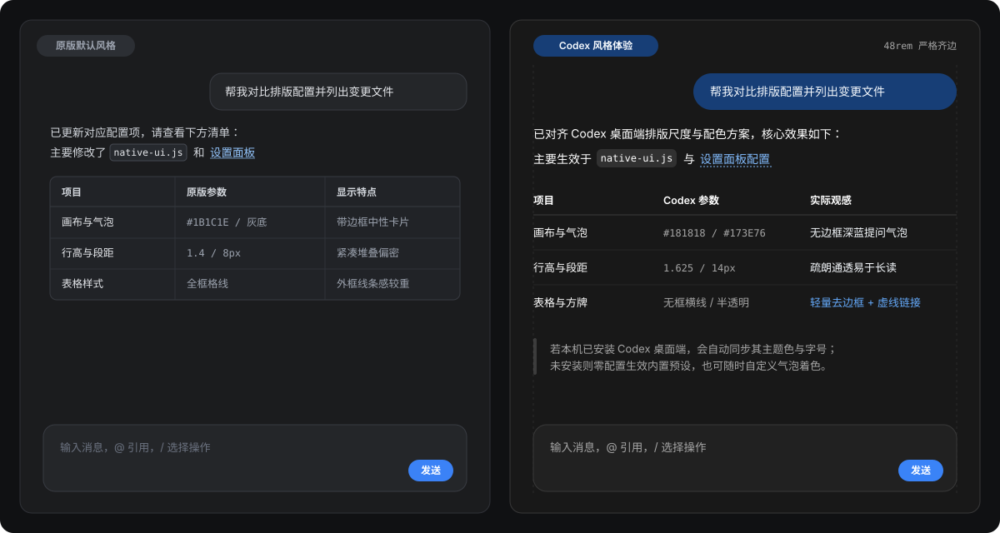
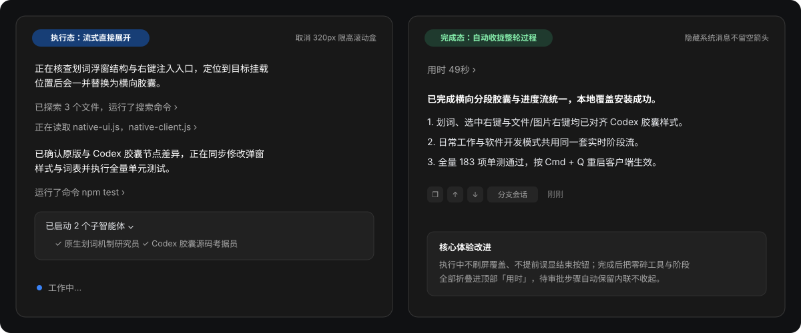
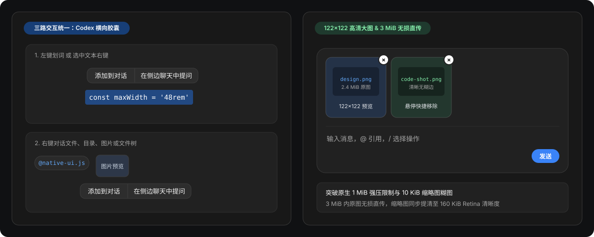
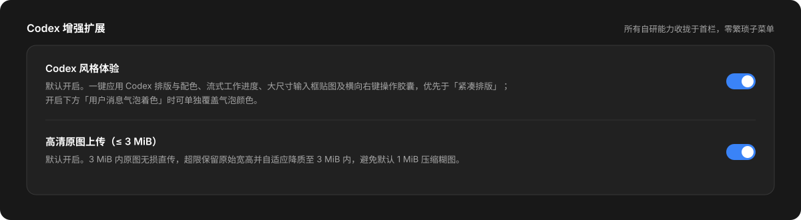

<div align="center">
  
  <h1>Agy Powertools (Codex Edition)</h1>
  <p><strong>Antigravity 2.0 enhancement plugin crafted to match the Codex desktop look and feel</strong></p>
  <p>Codex typography &amp; palette, unified live progress folding, horizontal action pills, 122×122 image previews &amp; 3 MiB HD uploads, telemetry, branching, multi-account &amp; no-TUN proxy</p>
  <!-- plugin-badges:start -->
  <p>
    <a href="https://github.com/BlueMiniFatFish/agy-powertools/releases"></a>
    <a href="https://github.com/WhiteBr1ck/agy-powertools/releases/tag/v2.16.3"></a>
    <a href="https://github.com/BlueMiniFatFish/agy-powertools/actions/workflows/ci.yml"></a>
    <a href="LICENSE"></a>
    
    = 22.13" />
    
  </p>
  <!-- plugin-badges:end -->
  <p>
    <a href="README.md">简体中文</a> |
    <strong>English</strong>
  </p>
  <p>
    <a href="#codex-experience-highlights">Codex Highlights</a> |
    <a href="#full-native-capabilities-retained">Native Features</a> |
    <a href="#installation">Installation</a> |
    <a href="#configuration">Configuration</a> |
    <a href="#changelog">Changelog</a>
  </p>
</div>

<p align="center">
  
</p>

> Built on top of [`WhiteBr1ck/agy-powertools`](https://github.com/WhiteBr1ck/agy-powertools) (MIT License). Attaches to Antigravity 2.0 via the local debugging interface and reads local session data in read-only mode without modifying client binaries or opening external web pages.

---

## Codex Experience Highlights

Built for an **out-of-the-box Codex desktop feel**, grouped cleanly into five visual and interactive pillars:

### 1. Conversation Typography & Palette
- **Authentic Codex visual scale**: Matches Codex dark/light canvases, flush `48rem` column alignment, airy `1.625` line height and spacing, borderless rounded user bubbles, soft inline code pills, dashed blue file links, and clean horizontal-rule tables.
- **Zero-config with auto-sync**: Works immediately with tuned built-in presets; silently syncs colors and font sizes from `~/.codex` when Codex is installed, and still lets you customize bubble tints anytime.

### 2. Live Progress Streaming, Auto-Fold & Concise Output
- **Unified across Knowledge Work and Software Engineering**: Removes the cramped `320px` scroll box while streaming stage updates in bright foreground and single-line muted tool summaries, hiding premature response action bars until work actually completes.
- **One-line completion fold**: Folds prior updates, wakeups, and subagent groups into a clean `Worked for …` line on completion, suppresses empty fold chevrons on hidden notices, and keeps approval prompts inline.
- **Global Codex output & localized tool-summary prompt**: With **Codex-style experience** enabled, automatically upgrades the dynamic `Stage updates` prompt section (without touching `~/.gemini/AGENTS.md`) to enforce conclusion-first brevity, restrained inline backticks, end-of-sentence `file://` links, and concise UI-language tool summaries, cleanly restoring the upstream rule when turned off.

<p align="center">
  
</p>

### 3. Horizontal Quote & Attach Action Pill
- **Unified across all three triggers**: Left-click text selection, selection right-click, and right-clicking chat files, folders, artifact cards, images, or the Files tree all present the crisp Codex segmented pill **Add to chat | Ask in side chat**, replacing the bulky vertical menu.

### 4. HD Image Uploads & Larger Composer Previews
- **Codex-sized attachment cards**: Pasted or attached images expand the composer cleanly with crisp `122×122` rounded thumbnails (`88×88` in Side Question) and hover remove buttons.
- **No more blurry 1 MiB downscaling**: Sends images up to 3 MiB losslessly at original resolution (adaptively compressing larger files near 3 MiB) and upgrades `10 KiB` thumbnails to `160 KiB` Retina clarity.

<p align="center">
  
</p>

### 5. Minimal Two-Switch Section & Expanded Localization
- **Clutter-free top section**: Keeps only two clear switches at the top of Settings (**Codex-style experience** and **HD original images (≤ 3 MiB)**) with full instant rollback and zero mixing into upstream sections.
- **Completed 2.35+ translations**: Covers subagent controls, background tasks, timer notices, permission prompts, pinned chats, and image menu labels in Simplified/Traditional Chinese.

<p align="center">
  
</p>

---

## Full Native Capabilities Retained

Includes every upstream `agy-powertools` telemetry, workflow, and system utility:

- **Context and speed telemetry**: Composer context ring (cache reuse, compactions, Orchestrator bars), speed dial (`tok/s`, TTFT, cost), and subagent stats.
- **Local usage & request dashboard**: `Powertools` sidebar page with 53-week heatmap, token/cost breakdown, per-request filtering, cache anomaly flags, and official API pricing lookup.
- **Full session branching & inline edit**: Fork full-history branches (including chats with subagents) or edit sent messages in place.
- **Multi-account & no-TUN proxy (off by default)**: OS keyring multi-account isolation with 5H/weekly quotas and per-app HTTP/SOCKS5 proxy flags.
- **SSH remote, WSL2 & titlebar popover**: Zero-server-install SSH telemetry, Windows WSL2 bridge support, and macOS cold-start auto-relaunch.

<details>
<summary><strong>Expand to view dashboard, multi-account, and telemetry previews</strong></summary>

<table>
  <tr>
    <th width="50%">Context Window &amp; Speed Stats</th>
    <th width="50%">Overview Task Progress &amp; Quota</th>
  </tr>
  <tr>
    <td></td>
    <td></td>
  </tr>
  <tr>
    <th>Usage Overview (Dark)</th>
    <th>Multi-Account &amp; Quota Manager</th>
  </tr>
  <tr>
    <td></td>
    <td></td>
  </tr>
</table>

</details>

---

## Useless Features (But Cool)

<p align="center">
  
</p>

- **Working composer border beam (off by default)**: Inspired by [border-beam-ios](https://github.com/ismnoiet/border-beam-ios), powered by a lightweight rounded-rectangle SDF WebGL shader. Glides a smooth comet and soft inner glow at constant speed around the composer while the agent is working, then fades out to zero idle CPU/GPU cost once the turn finishes. Cross-fades seamlessly with the Composer Quota Halo when both are enabled, and includes 6 palettes (`Gemini`, `Aurora`, `Colorful`, `Neon`, `Accent`, `Quota`) plus a live **Try preview** button in Settings.

---

## Installation

> Requirements: Antigravity installed and started at least once. Uses local Node.js `>= 22.13` or falls back to Antigravity's bundled `agy-node`. No `npm install` or admin privileges needed.

### Option 1: Let an Agent install it (recommended)

Send this prompt to Antigravity or another local coding agent:

> Please install Agy Powertools (Codex Edition) from https://github.com/BlueMiniFatFish/agy-powertools . Read README_EN.md and docs/INSTALL_AGENT.md first, and run the unified installer provided by the project using local Node.js or Antigravity's bundled runtime. Keep all other plugins, account settings, and chat history intact, and do not force-close the running client. Verify the installed version afterward and remind me if a client restart is needed.

See [Agent installation guide](docs/INSTALL_AGENT.md) for details.

### Option 2: Command line

Download and extract the latest ZIP from [Releases](https://github.com/BlueMiniFatFish/agy-powertools/releases) (or clone this repository), then run:

```powershell
# Windows (PowerShell)
powershell -NoProfile -ExecutionPolicy Bypass -File .\install.ps1
```

```sh
# macOS / Linux / WSL2
sh ./install.sh
```

Reinstalling keeps your saved settings and does not force-close Antigravity. Restart Antigravity once you finish your current task; **Powertools** will appear in the left sidebar. On macOS, no duplicate `.app` launcher is created: opening the original `Antigravity.app` automatically relaunches once with the debug flag when needed (with built-in loop protection, and a toggle in Settings or Plugins -> Powertools to switch to manual restart anytime).

### Updates and uninstall

- **In-app updates**: Go to **Powertools -> Settings -> About -> Check for updates** and click **Install update**. Packages are SHA-256 verified and roll back automatically if startup fails.
- **Uninstall**: Run `powershell -NoProfile -ExecutionPolicy Bypass -File .\uninstall.ps1` (Windows) or `sh ./uninstall.sh` (macOS / Linux / WSL2). Append `--keep-settings` to keep your preferences. Native chat history, accounts, and other plugins are untouched.

---

## Configuration

Every setting applies live in **Powertools -> Settings** and saves automatically (**Restore defaults** is at the bottom).

<details>
<summary><strong>Expand all settings, environment variables, and paths</strong></summary>

### Codex Extensions (2 clean top-level switches)

| Setting | Default | Description |
| --- | --- | --- |
| Codex-style experience | On | Applies Codex typography and palette, live progress timeline, 122×122 composer previews, and horizontal action pills (auto-syncs `~/.codex` with built-in defaults), overriding Compact layout |
| HD original images (≤ 3 MiB) | On | Sends images up to 3 MiB losslessly at original dimensions (adaptively compresses larger files near 3 MiB) and upgrades thumbnails instead of 1 MiB downscaling |

### Interface & display

| Setting | Default | Description |
| --- | --- | --- |
| Enable Powertools | On | Master switch; pauses all UI enhancements while keeping saved settings |
| Language | `简体中文` | Choose `简体中文`, `繁體中文`, or `English` |
| Compact layout | On | Tightens line height (`1.4`), block spacing, and tool rows while keeping client font size |
| Tint user message bubbles | Off | Adds a tint and border to user messages (Accent, 5 presets, custom color, and 10%-100% blend slider) |
| Always show conversation outline | On | Keeps the turn navigation rail visible in multi-turn chats |
| Keep Overview open when switching chats | On | Preserves the right Overview panel open state across conversations |
| Conversations per project | `Default (6)` | Controls visible chats per project in the sidebar (`Default (6)`, `1-10`, or `Show all`) |
| Taskbar unread badge | On | Shows `(N)` unread count in the window and taskbar title when background chats finish |

### Telemetry & progress

| Setting | Default | Description |
| --- | --- | --- |
| Default Overview range | `Current weekly quota` | Choose weekly quota cycle, Today, 24h, Yesterday, This week, This month, 30d, or All time |
| Context ring | On | Shows context usage ring, cache reuse breakdown, and Orchestrator per-model bars |
| Speed & statistics | On | Shows the speed dial and opens session telemetry and estimated cost |
| Task progress | On | Collapsible Overview section with checklist progress, live phase, and step durations |
| Show quota in Overview | Off | Collapsible Overview section showing 5-hour and weekly remaining quotas |
| Titlebar quick overview | Off | Adds a top-right titlebar Powertools trigger to open the full 6-tab popover over your current chat |
| Composer quota halo | Off | Draws remaining quota clockwise around the composer card (emerald, amber, or red) |
| Quota halo window | `Auto (lower)` | Choose `Auto (lower)`, `Weekly limit`, or `5-hour limit` when the halo is enabled |
| Working composer border beam | Off | Animates a smooth border beam around the composer while working (zero idle cost), transitions cleanly with the quota halo, with 6 palettes and Live preview |
| Subagent context & telemetry | On | Shows per-subagent model, context usage, tokens, cache hit rate, speed, and cost |
| Turn duration / Expand tools | On | Shows total duration on finished turns and expands tool details on click |

### Enhancements, Accounts, Proxy & Experimental Context

| Setting | Default | Description |
| --- | --- | --- |
| Stage updates | On | Reports brief progress updates during tool runs and folds them on completion |
| Parallel search & read | Off | Guides the agent to batch file searches and reads in one turn |
| Full-text search in native picker | On | Extends the native conversation search modal to search message bodies, code blocks, and commands, jumping straight to the matched turn |
| Branching / Message edit / File menu | On | Native session branching, inline message editing, and local/NAS/Files tree context menu (with dynamic Open With apps and `#L:C` jump) |
| Recognize pasted SSH commands | On | Extracts `user@host:port` when pasting `ssh -p PORT user@host` into Create New Project -> SSH Host (discards appended passwords) |
| Enable multi-account switching | Off | Opt-in with risk notice; sidebar switcher, list/card views, 5H/weekly toggle, and auto-switch |
| Application proxy (no TUN) | Off | Protocol/host/port fields, connectivity checks, cold-start prompt, and Force HTTP/1.1 |
| Context target (Experimental) | `Default` | Choose `Default`, `256K`, `500K`, or `1M` (`Default` leaves native settings unchanged) |

### Environment variables & paths

| Name / Path | Description |
| --- | --- |
| `ANTIGRAVITY_USER_DATA_DIR` | Custom Antigravity user-data directory for isolated profiles |
| `ANTIGRAVITY_CDP_PORT_FILE` | Explicit path to `DevToolsActivePort` (also honors `AGY_BROWSER_ACTIVE_PORT_FILE`) |
| `~/.gemini/config/plugins/agy-powertools/` | Installed plugin files and runtime scripts |
| `~/.gemini/antigravity/plugin_data/agy-powertools/` | Saved settings, account metadata, quota samples, and pricing cache |

</details>

---

## Changelog

### v1.1.0 (Synced with upstream v2.16.0 - v2.16.3)
- **Deeper Codex desktop experience & guaranteed override**:
  - Integrates all updates from [`WhiteBr1ck/agy-powertools`](https://github.com/WhiteBr1ck/agy-powertools) `v2.16.0` through `v2.16.3` while guaranteeing that Codex typography, live progress streaming, horizontal quote/attach pills, and HD image uploads override upstream rules; turning off Codex Style cleanly falls back to upstream's new chat image context menu (attach, copy, save).
  - Restyles the left sidebar with Codex proportions and dark palette (#202020 canvas, 14px scale, #323232 borderless active pill while keeping native pinned chats and project folders), converts editor/selection quotes into compact composer-top pills and sent pill badges, adds right-click thinking effort switching on the model selector, auto-collapses finished work steps without mid-stream flicker, and refines code cards, hover action bars, shimmer timing, and hook rows.
- **Upstream `v2.16.0` - `v2.16.3` highlights integrated**:
  - Adds automatic update checking, in-app notifications, and optional same-major idle auto-install (#45) with a 12-hour TTL, immediate check after client upgrades, clickable sidebar badge, titlebar status dot, and bottom-right reminder card.
  - Adds the Overview 3D `ThinkingOrb` particle sphere, theme-adaptive delegated tooltips, standard vs. API promo pricing-basis toggle, final-answer-only Copy extraction, instant `/compact` checkpoint ring estimation, and chat inline image context actions.
  - Resolves long-chat stutter with O(1) turn caching and scroll deferral (#51), fixes post-restart initial turn inline edit (#58), completes Antigravity 2.35.1 Skills/Customizations/MCP i18n with diff exclusions (#55/#60), exposes copyable OAuth URLs (#56), syncs ToS state across account switches (#59), isolates SSH remote windows from local accounts (#49/#57), and switches Windows cold-start proxy relaunch to zero-AMSI temporary `.lnk` shortcuts (#53).

### v1.0.0 (Initial Release, synced with upstream v2.15.5)
- **Independent Codex Edition release (integrating all features from [`WhiteBr1ck/agy-powertools`](https://github.com/WhiteBr1ck/agy-powertools) `v2.15.5`)**:
  - **Conversation typography & palette**: Matches Codex light/dark canvases, flush `48rem` alignment, `1.625` line height and spacing, borderless user bubbles, soft inline code pills, dashed blue file links, and horizontal-rule tables (auto-adapts `~/.codex` when present or falls back seamlessly to built-in defaults).
  - **Live progress streaming & auto-fold**: Unifies Knowledge Work and Software Engineering stage streaming without the `320px` scroll box, hides premature action bars while working, folds completed steps into a clean `Worked for …` header, and suppresses empty chevrons on hidden notices.
  - **Horizontal quote & attach action pill**: Unifies text selection, selection right-click, and chat file/folder/artifact/image/Files tree right-click into Codex's **Add to chat | Ask in side chat** segmented pill, overriding the vertical menu.
  - **HD image uploads & 122×122 composer previews**: Expands the composer cleanly with `122×122` rounded thumbnails and hover remove badges, sends images up to 3 MiB losslessly, and boosts thumbnails to `160 KiB` Retina clarity.
  - **Minimal two-switch section & 2.35+ localization**: Consolidates all custom controls into two switches at the top of Settings and fills remaining subagent, background task, timer, approval, and icon glyph gaps.

<details>
<summary><strong>View upstream base release history (v2.10.0 - v2.15.5)</strong></summary>

### v2.15.5
- **macOS single-app launch with automatic cold-start relaunch**:
  - No longer creates a duplicate `~/Applications/Antigravity (Powertools).app` wrapper (automatically cleans up legacy wrappers on upgrade) so you simply open the original `/Applications/Antigravity.app`.
  - Automatically relaunches once with `--remote-debugging-port=0` on cold start when the debug port is absent (drops `osascript` to avoid macOS Automation permission prompts, guarded by per-session tracking, a 120s cooldown, and a 2-attempt circuit breaker).
  - Adds an opt-out **Auto-relaunch on cold start (macOS)** toggle in both **Powertools -> Settings** (macOS only) and the native **Plugins -> Powertools** side pane alongside the manual **Restart to Enable** button.

### v2.15.4
- **Fix long-conversation touch-scroll lag and Windows IME toolbar flicker (#37)**: Added dirty checks for `<html>` style properties, render-signature skipping for unchanged historical turns, WeakMap caching for completed responses and flex anchors, `[contenteditable]` / `[data-markdown-root]` observer filtering, touch-drag and IME composition mount deferral, and throttled pruning in `native-i18n.js`.
- **Fix streaming speed calculation (#36)**: Excludes TTFT for genuine streamed responses (`streamingMs >= 500ms` and `outputTokens >= 20`) while keeping whole-request fallback for short buffered tails, and adds a full hover breakdown (decode speed, end-to-end throughput, TTFT, streaming duration) in the Requests table.
- **Faster Overview loading with shimmer skeletons**: Decoupled local dashboard loading from slow remote quota RPCs and added equal-height shimmer skeletons for Overview and EventTable on initial load instead of flashing placeholder zeros.
- **Titlebar quick overview multiline status tooltip and dismissible first-time alert (#38, thanks `@Hi-Jiajun`)**: Explains active low-quota or pending-proxy alerts in a multiline hover tooltip and a dismissible callout with Got it / Don't remind (restorable in Settings).
- **Paste SSH connection commands (#33, thanks `@wangbingnan136`)**: Extracts `user@host:port` when pasting `ssh -p PORT user@host` into the native SSH Host input while discarding any appended password, toggled under Conversation enhancements.

### v2.15.3
- **Fix Windows "Open containing folder" falling back to Documents on paths with spaces**: Pass `/select,"<path>"` with `windowsVerbatimArguments: true` for all non-root Windows reveal calls (fixing both "Open containing folder" and "Open with > File Explorer", plus direct open for drive roots) without affecting macOS or Linux.

### v2.15.2
- **Working composer border beam (off by default; inspired by [border-beam-ios](https://github.com/ismnoiet/border-beam-ios))**:
  - Uses a lightweight rounded-rectangle SDF WebGL shader parameterized by perimeter arc length so the comet and soft inner glow glide at constant linear speed around any composer aspect ratio, fading out cleanly to zero idle CPU/GPU cost (with `prefers-reduced-motion` and SVG fallback support).
  - Seamlessly cross-fades with the Composer Quota Halo when both are enabled: the quota ring fades out completely while the working beam runs, then returns smoothly once the turn finishes.
  - Enable in **Powertools -> Settings -> Telemetry & progress** to choose from 6 curated palettes (`Gemini`, `Aurora`, `Colorful`, `Neon`, `Accent`, `Quota`) and toggle **Try preview** to test palettes live on any chat composer.

### v2.15.1
- **Titlebar quick overview popover (off by default; thanks `@Hi-Jiajun` for the concept and titlebar mount in #32)**: Enable **Titlebar quick overview** in **Powertools -> Settings -> Telemetry & progress** to add a `28x28` trigger next to top-right titlebar actions (with low-quota / pending-proxy indicator dot) that opens all 6 full panels right over your current conversation.
- **Streamlined single-row About card**: Combines project link, version pill, and a single morphing update button (check, inline spinner, up-to-date state with zero layout shift, and one-click install stages) into one compact card.

### v2.15.0
- **Full-text transcript search integrated directly into the native search modal (thanks `@wangbingnan136` for the search engine foundation in #24)**: Typing in the native Conversations picker now displays local and SSH message body, code block, and terminal command matches right inside the modal with scope pills, one-click copy, and direct turn jump (zero visual change when empty).
- **Dynamic "Open with >" submenu in the file context menu (with `#L:C` line jump)**: Auto-detects installed editors, IDEs, and terminals on Windows, macOS, and Linux without extra settings; fixes Windows percent-encoded drive colons (`file:///d%3A/...`) and hardens Windows `.cmd` spawning against shell metacharacters.
- **Multi-account quota refresh reliability and display accuracy (#28, thanks `@Hi-Jiajun`)**: Added request sequencing and `.db/-wal` incremental caching to prevent UI stalls and stale overwrites, unified active account live quota views, filtered untouched `100%` placeholder countdowns, and marked expired inactive estimates with `≈` alongside weekly risk cues.
- **UI polish and fixes**:
  - Added a `10%-100%` blend strength slider (up to solid fill with automatic text contrast) for user message bubble tinting (#27).
  - Fixed Overview Quota `5h 100%` wrapping on macOS (#25), merged native `Worked for` headers with Powertools turn durations to prevent duplicate rows (#29), and refined Chinese Side Question terminology.

### v2.14.3
- **Antigravity 2.35.0 compatibility**: Updated native popover content (`JC`) binding detection for Antigravity 2.35.0 while keeping backward compatibility with 2.34.0, restoring all native panels and popovers.
- **Expanded 2.35.0 localization**: Added translations for sentence-cased settings labels, updated descriptions, and menu actions (`Load older messages`, `Delete Permanently`, `Return to Inbox`).

### v2.14.2
- **Fixed multi-account in-place "Add account" reverting to the previous account after ~50 minutes and clobbering backup credentials (#22, #23, thanks `@Hi-Jiajun` for the investigation and PR)**:
  - Added cross-platform `id_token_email` ownership verification across Linux, macOS, Windows, and WSL2 credential vaults so mismatched credentials never overwrite another account's vault slot or pollute quota records (with graceful fallback for opaque non-JSON tokens).
  - Added `accounts.completeAdd` after in-place sign-in to set the `pendingSwitch` guard and trigger a clean relaunch when the account changes or tokens rotate (clearing stale `language_server` `TokenSource` instances, degrading cleanly to `manualRestartRequired` when relaunch is unavailable, and skipping relaunch on cancelled sign-ins).

### v2.14.1
- **Fixed Overview Task Progress showing Complete while subagents or background tasks are running**: Keeps yielded main turns active when child subagents or non-daemon background tasks (`notFullyIdle`) are still running, adds dedicated `Subagent running` and `Waiting for background tasks` phases (without flagging long-running daemon servers), matches `SYSTEM_MESSAGE` wakeup turns inside the active turn, and aligns unread badge and auto-switch checks.
- **Expanded Swarm panel localization**: Added missing empty-pane guidance, Hive legends, dynamic member/post/frame counts, task completion states, GIF export progress, and dynamic tooltip translations while preserving the `Swarm` entry label and post bodies.

### v2.14.0
- **Windows Antigravity + WSL2 backend support (#21, thanks `@Hopeless` for the design and testing)**:
  - Detects WSL2 and resolves Windows `%APPDATA%\Antigravity\DevToolsActivePort`; connects directly in Mirrored mode and falls back to a Windows `node.exe` / `agy-node.exe` TCP-over-stdio bridge in default NAT mode.
  - Adds `vault.probe()` with explicit error reporting; pairs atomic `0600` WSL2 token/scope files with isolated Windows Credential Manager backup slots (`agy-powertools:wsl:<distro>:account:<id>`).
  - Delegates `.lnk` maintenance and `Antigravity.exe` relaunch to Windows `powershell.exe` from WSL2, falls back to `manualRestartRequired` if relaunch fails after switching, and cleans up dead-PID runtime JSON files on startup.

### v2.13.9
- **Windows LAN NAS / SMB share support for file context menu**: Validates literal IPs or resolves hostnames via `dns.lookup` before touching SMB, allowing access only when every resolved IP is non-global (LAN IPs, NetBIOS names, split-DNS internal domains, Tailscale/VPN private IPs, `*.localhost`, and `wsl$`) while continuing to block public hosts; fixes quoting for UNC paths with spaces in `explorer.exe /select`.

### v2.13.8
- Mounted the composer quota halo directly on `.surface-composer-card` so it no longer outlines project/branch bars on New Chat.
- Added `Quota halo window` selector (`Auto (lower)`, `Weekly limit`, or `5-hour limit`).
- Fixed Markdown formatting in `Settings -> About -> Release notes`.

### v2.13.7
- Added opt-in Overview quota display and composer quota halo (#18), and made Overview `Task progress` and `Quota` collapsible.
- Added incremental checkpoint calibration for multi-device weekly quota estimates (#19).
- Removed Windows hidden PowerShell taskbar flashing calls to prevent AV false positives, and disabled the unused legacy `hooks.json` hook (#20).
- Added translations for sidebar project menus, permission approval dialogs, `Thought for Xs`, and `Step X of Y`.

#### Earlier releases (v2.10.0 - v2.13.6)

- **v2.13.6**: Streamlined Overview Task Progress with integrated live phase header, connected timeline, per-step durations, live timer, and Orchestrator tooltip translation.
- **v2.13.5**: Added opt-in User Message Bubble Tint, tightened Requests table columns, fixed `#` paths in `file://` links, and expanded 2.34.0 translations.
- **v2.13.4**: Defaulted Overview to Current weekly quota (#12), added OpenSSH remote window telemetry (#14), per-account quota isolation and filtering (#9, #11), attach files/images from context menu, Swarm iframe localization (#10), and split-pane/edit/polling fixes (#15).
- **v2.13.3**: Full-history branching for conversations with subagents, macOS native launcher icon and Dock guide (#7, #8), and 2.34.0 menu translations.
- **v2.13.2**: Cache hit rate metrics and short-interval cache anomaly detection (#6), Traditional Chinese (`zh-TW`), Orchestrator updates, and dynamic Claude pricing parsing.
- **v2.13.1**: Subagent context & telemetry, live execution phases in Task Progress, Today Overview range, and Aux Pane fallback updater.
- **v2.13.0**: Antigravity 2.34.0 compatibility, opt-in multi-account switching, opt-in no-TUN application proxy, inline edit suspension, and packaged README badge fix (#5).
- **v2.12.0 - v2.12.10**: In-app verified updater, component caching, inline message editing, taskbar unread badges, split context/speed popovers, file context menu (#2), sidebar project limits, and stability fixes (#1, #3, #4).
- **v2.10.0 - v2.11.0**: Antigravity 2.32.x support, paired token/cost donuts, and master switch.

</details>

---

## License & Links

- **License & Attribution**: [MIT License](LICENSE) (Codex Edition built on [`WhiteBr1ck/agy-powertools`](https://github.com/WhiteBr1ck/agy-powertools); custom date-range calendar adapted from HextaUI using `react-day-picker` and `date-fns`; see [lib/vendor/NOTICE.txt](lib/vendor/NOTICE.txt))
- **Issues**: [GitHub Issues](https://github.com/BlueMiniFatFish/agy-powertools/issues) (please include OS, Antigravity version, and plugin version)
- **Community**: [LINUX DO](https://linux.do/)
